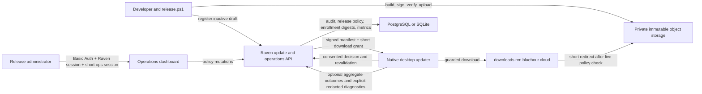
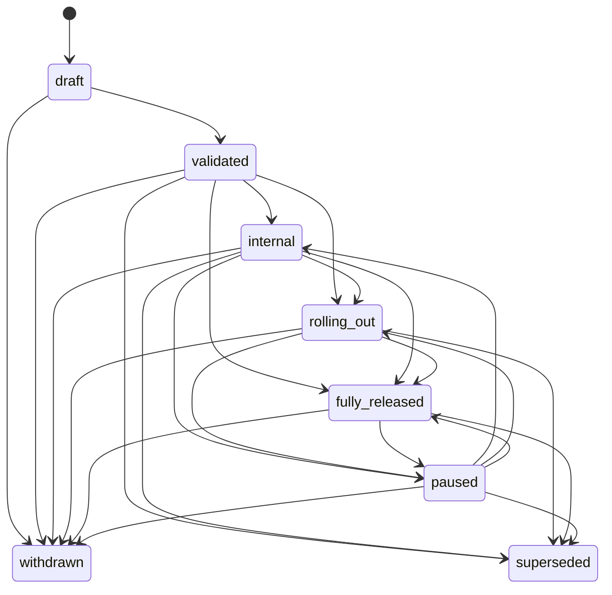

# Raven desktop updates: architecture, release operations, and incident guide

This guide explains Raven's desktop update system from the first version change in Git to an installation reaching healthy startup. It is written for developers, release administrators, incident responders, and anyone who needs to understand what the Operations dashboard changes for real users.

The short version is:

1. A developer builds and registers an immutable, signed **draft**.
2. A release administrator validates the draft and deliberately publishes it to selected **cohorts** in an update **channel**.
3. Each enrolled installation receives a deterministic rollout **bucket**, so percentages expand without reshuffling people.
4. The desktop checks policy, downloads through a guarded URL, verifies the signature, size, and hash, and asks the user before installation.
5. Raven revalidates policy immediately before installing. A pause, withdrawal, block, channel disable, or rollout change can therefore stop an already-downloaded update.
6. Optional aggregate **outcomes** show whether stages are succeeding. Separately consented, redacted **diagnostics** help explain failures.
7. Required updates and version blocks can restrict communication, but they never silently restart Raven or bypass artifact and compatibility checks.

The rest of this document builds that story gradually, then ends with a complete operation reference and practical checklists.

## How to use this guide

- For a first read, follow [The journey of Raven 0.5.0](#the-journey-of-raven-050), [Architecture](#architecture-five-boundaries-with-different-jobs), [Core concepts](#core-concepts-and-object-types), and [The normal rollout playbook](#the-normal-rollout-playbook) in order.
- When preparing a build, jump to [Building and registering a new release](#building-and-registering-a-new-release) and [Before building](#before-building).
- During routine operations, use [Entering and reading the Operations dashboard](#entering-and-reading-the-operations-dashboard) and the [Operation encyclopedia](#operation-encyclopedia-every-release-and-policy-control).
- During an incident, start with [Incident stories and the correct response](#incident-stories-and-the-correct-response), then use the linked emergency/recovery runbooks.
- For implementation work, use [Public update flows](#public-update-flows-and-routes), [Protected operations API](#protected-operations-api-reference), and the focused API/threat-model documents.

## Meet the example installations

The same imaginary installations appear throughout the guide:

| Owner | Installation settings | Bucket | Situation |
|---|---|---:|---|
| Mina | `alpha`, assigned and selected `internal` | `0712` | Raven maintainer on Windows, automatic download enabled |
| Ali | `alpha`, `friends` | `0241` | Closed-alpha participant on Linux |
| Sara | `alpha`, `friends` | `6840` | Closed-alpha participant on Windows |
| Reza | `stable`, `friends` | `4030` | Cautious user who does not want alpha releases |
| Nika | `alpha`, `friends` | `0180` | Windows laptop on a metered connection |
| Omid | `alpha`, `friends` | `0870` | Outcome sharing enabled; detailed diagnostics disabled |

These are installations, not update-system user records. Raven intentionally does not keep an account-linked table saying that Mina or Ali has a particular desktop version. The names make the examples readable; the update service actually works with a random local installation identifier, its one-way digest, consent, channel, cohort, and bucket.

## The journey of Raven `0.5.0`

Imagine that a developer has finished Raven `0.5.0`.

The release tool first refuses to proceed unless all version declarations agree and Git has a committed, clean `HEAD`. It builds a Windows x86-64 NSIS package on the release workstation and a Linux x86-64 AppImage in a pinned Linux build environment on the homelab. The unsigned Linux result returns to the workstation. The updater private key never leaves that workstation.

Both artifacts are signed and verified locally. The tool also creates SHA-256 checksums, CycloneDX SBOMs, and provenance records. It uploads every file under a versioned, immutable key and verifies the complete uploaded bytes. Finally, it registers `0.5.0` in the API as a **draft**.

Nothing has been offered to Mina, Ali, Sara, Reza, Nika, or Omid yet.

A release administrator opens the Operations dashboard, examines the release and artifacts, enters a reason, and validates the draft. Validation checks the registered platform artifacts and their evidence against object storage. The release is now **validated**, but still inactive.

The administrator publishes with these cohort percentages:

| Cohort | Percentage |
|---|---:|
| `internal` | 100% |
| `friends` | 5% |

Mina is eligible because she is in `internal`. Ali and Nika are eligible because their buckets are below `0500`. Sara is not eligible because `6840` is outside the first 5%. Reza sees nothing because he chose `stable`, while this release belongs to `alpha`.

Mina's desktop checks policy, receives the signed manifest, and downloads the update. If she is in a Nest, Raven may download safely in the background, but **Restart now** remains unavailable until the communication activity ends. The update never takes control of an active conversation.

Nika is on a metered Windows connection with the default `ask` behavior. Raven does not automatically download. It displays the exact byte count and lets her approve that particular download.

The administrator later expands `friends` from 5% to 25%. Ali and Nika stay included, because rollout buckets do not change. Sara remains outside the rollout because `6840` is greater than `2499`. At 70%, Sara becomes eligible. This monotonic behavior is the main reason Raven uses deterministic buckets rather than choosing a fresh random sample on every check.

That is the normal story. The architecture exists to keep the same story safe when a build is bad, a server changes, a user is offline, or an operator makes a mistake.

## Architecture: five boundaries with different jobs



### 1. The release workstation is the signing boundary

The workstation owns the Tauri updater private key and its DPAPI-protected password. It builds or receives both platform payloads, signs them, verifies them against the public key embedded in Raven, and uploads immutable artifacts.

Why this exists: a server compromise must not automatically become a signing-key compromise. The homelab can build Linux, serve policy, and grant downloads without possessing the private update key.

Project benefit: an attacker who changes a database row or object-storage response still cannot create a payload accepted by an existing Raven desktop.

### 2. Object storage is the immutable evidence boundary

Artifacts live under:

```text
desktop/<channel>/<version>/<platform>/x86_64/
```

Each target has an updater package, signature, checksum, SBOM, and provenance object. Uploads use create-only semantics. Existing objects are not overwritten, and a partial multi-object upload is not cleaned up by deleting evidence.

Why this exists: the meaning of version `0.5.0` must never change after anyone has inspected or installed it.

Project benefit: operators can reproduce incident evidence, and a corrected build must use a new semantic version instead of silently replacing old bytes.

### 3. The Go API is the policy boundary

The API owns consent, enrollment digests, channels, cohorts, releases, rollouts, compatibility, version blocks, guarded download grants, rollback approval, outcomes, diagnostics, and the immutable operations audit.

Why this exists: a valid signature proves who signed bytes; it does not answer whether those bytes are currently approved for this channel, cohort, server version, protocol, or installed version.

Project benefit: release policy can be paused or repaired immediately without rebuilding the API or modifying stored artifacts.

### 4. The Operations dashboard is the human-control boundary

The dashboard is a private React application at `https://ops.rvn.bluehour.cloud`. It displays release state and evidence and performs audited policy changes. It does not receive the updater signing key, object-storage credentials, database credentials, or unrestricted administrative access.

Why this exists: routine rollout work should be understandable and reviewable without direct SQL, direct S3 manipulation, or memorized API calls.

Project benefit: operators get typed confirmation for dangerous actions, required reasons, clear state, and a chronological audit instead of making invisible infrastructure changes.

### 5. Native Rust in the desktop is the installation boundary

The React Settings screen only displays snapshots and requests actions. Native Rust owns the updater state machine, service URLs, public key, signature/hash/size checks, staging files, installation, rollback, redaction, concurrency locks, and persistence. Mutating updater commands are accepted only from the main Raven window, not overlays or secondary Nest/media windows. Only one long-running/network updater operation such as check, download, install, rollback, or diagnostic sharing runs at a time.

Why this exists: a webview should not be the authority that decides whether untrusted bytes become an installed executable.

Project benefit: UI bugs and secondary windows cannot bypass native validation or start concurrent update mutations.

## The four questions Raven never combines

Most updater mistakes come from treating “there is a new version” as one Boolean. Raven deliberately asks four independent questions:

1. **What was built?** A `Release` points to exact, signed `Artifact` records and source provenance.
2. **Who may discover it?** `Channel`, lifecycle state, `Cohort`, and `Rollout` decide eligibility.
3. **May this installation safely use or install it?** Consent, `Compatibility`, `VersionBlock`, current server/protocol/capabilities, and fresh verification answer this.
4. **May this operator change the policy?** Release-administrator permission, short sessions, action reauthorization, typed confirmation, reason, and `AuditEvent` answer this.

Because these questions are separate:

- uploading does not publish;
- validating does not publish;
- publishing to maintainers does not publish to friends;
- 100% rollout in `alpha` does not affect `stable`;
- a required update cannot bypass signatures or compatibility;
- a downloaded update can be stopped before installation;
- and a database administrator is not automatically a release administrator.

## Core concepts and object types

### Channel: the long-lived stream

Current channels are `alpha` and `stable`.

A channel is selected on each desktop in **Settings → Updates**. An operator publishes a release into a channel but does not assign an account to a channel. Changing channel is an explicit installation setting; Raven checks whether the requested selection is currently allowed before saving it.

- `alpha` is for closed-alpha and earlier testing.
- `stable` is for the more conservative release stream. `release.ps1` rejects prerelease semantic versions for stable; direct backend draft creation does not currently repeat that guard, so do not use the API to bypass the release tool.

Why channels exist: experimental and conservative release histories need independent version sequences and emergency switches.

Benefit: Mina can test an alpha release while Reza's stable installation remains completely unaffected.

Disabling a channel stops new discovery and invalidates downloads through live revalidation. It preserves release and rollout records so the exact policy can resume when the channel is enabled again.

### Cohort and cohort assignment: the audience inside a channel

Seeded backend cohorts are:

| Cohort | Intended use | Current desktop support |
|---|---|---|
| `internal` | Maintainers and release operators | Selectable, but requires a backend assignment for this installation |
| `friends` | Normal closed-alpha participants | Selectable and the default; no special assignment required |
| `staging` | Disposable release validation | Seeded in the backend and visible in Operations; not exposed by the current desktop selector |

A named assignment belongs to a one-way digest of a local installation ID, not to a Raven account. To use `internal`, both sides must agree:

1. the installation has been assigned to `internal` by a release administrator; and
2. that desktop requests `internal` in its update settings.

Merely selecting `internal` does not grant access. Merely assigning it does not silently change the user's setting.

Why cohorts exist: operators need to expose one channel first to trusted maintainers and later to the wider alpha group without producing different binaries.

Benefit: `internal: 100%` and `friends: 5%` can coexist safely.

Why assignments use installation digests: Raven avoids turning update operations into account-linked surveillance. The backend never stores the raw installation identifier.

Consent withdrawal deletes the enrollment, outstanding download grants, and named cohort assignment. Rejoining `internal` therefore requires a new consensual assignment.

### Enrollment and rollout bucket: stable, private eligibility

After delivery consent, Raven creates a local random installation UUID. The service derives a deterministic bucket from `0` through `9999` from that ID, then stores only the ID's digest and derived bucket plus channel, cohort, consent version, and timestamps. It does **not** store username or installed version.

Rollout percentages map to bucket ranges:

| Percentage | Eligible buckets |
|---:|---|
| 0% | none |
| 5% | `0000–0499` |
| 25% | `0000–2499` |
| 100% | `0000–9999` |

Why enrollment exists: update delivery needs consent and stable eligibility without account identity.

Benefit: expanding 5% to 25% keeps every previously eligible installation in the rollout.

### Release: the complete policy record around one version

A release contains:

- semantic version and channel;
- classification and lifecycle state;
- release notes and exact 40-character Git commit;
- client protocol version;
- optional minimum and maximum server versions;
- required client capabilities;
- optional required-update grace end;
- local data schema version;
- migration reversibility and rollback-safety declarations;
- an optional superseding release;
- an optional approved rollback target;
- revision, timestamps, artifacts, and cohort rollouts.

Why a release is more than a file: Raven must bind the payload to source, compatibility, data-migration safety, rollout policy, and operator decisions.

Benefit: a release can be inspected and controlled as one coherent object, and changing its revision invalidates old download grants.

`(channel, version)` is unique. The same semantic version cannot ambiguously refer to two alpha payloads.

### Artifact: one verified platform payload

Current supported artifacts are:

- Windows x86-64 NSIS;
- Linux x86-64 AppImage.

macOS is **not** supported by this update/release pipeline today.

An artifact record contains object key, signature, SHA-256, byte size, checksum sidecar and hash, CycloneDX SBOM and hash, provenance object and hash, and verification timestamp.

Why artifacts are separate from releases: one policy release needs exact evidence for each platform.

Benefit: an investigation can distinguish a Windows installer failure from a Linux package while retaining a shared release policy.

A draft may be registered while incomplete, but validation requires exactly one verified Windows x86-64 artifact and one verified Linux x86-64 artifact plus their evidence.

### Rollout: a percentage per release and cohort

A rollout is one percentage for one release/cohort pair. The API accepts `0–100`; storage uses basis points `0–10000`.

Why it exists: Raven can expose the same signed release gradually and independently to `internal` and `friends`.

Important rules:

- publishing/configuring requires at least one rollout entry;
- cohorts must be unique, known, and active;
- changing percentages preserves installation buckets;
- omitted cohorts retain their prior value; send an explicit `0` to stop an existing cohort;
- `fully_released` does not silently set every percentage to 100%; percentages remain the actual eligibility rule;
- a required release or a repair target for a blocked installed version bypasses rollout rows and percentages.

That last rule is critical: **0% is not an emergency stop for a required release.** Pause, withdraw, or disable the channel instead.

### Classification: how strongly Raven treats an update

Valid release classifications are:

| Classification | User effect | Service effect |
|---|---|---|
| `optional` | Normal offer; user may defer | No communication gate |
| `recommended` | Stronger guidance; user may still defer | Raises effective recommended version when discoverable |
| `required` | Recovery-focused update flow | Bypasses percentage; after grace, raises effective minimum and gates normal communication |

`blocked` is not a valid release classification. It is a decision classification produced when the **installed version** matches a `VersionBlock`.

A release can be promoted to `required`; there is no operation to change optional to recommended, or to demote required to recommended/optional. Version, channel, notes, commit, compatibility bounds, protocol, schema declarations, and artifact metadata are also immutable after draft registration. Wrong metadata requires a new semantic version, not SQL edits, deletion, or in-place repair.

Required never means forced restart. It controls server access and eligibility, while active-session and installation safety remain desktop responsibilities.

### Lifecycle state: whether a release is discoverable



| State | Meaning |
|---|---|
| `draft` | Registered but inactive and not yet server-validated |
| `validated` | Both platform payloads and evidence verified; still inactive |
| `internal` | Discoverable only to properly assigned internal/staging installations with matching rollout entries |
| `rolling_out` | Discoverable to active cohorts according to percentages |
| `fully_released` | Operator intent says full release; stored percentages still govern actual eligibility |
| `paused` | Temporarily undiscoverable; remembers the prior state for resume |
| `withdrawn` | Permanently removed from normal discovery |
| `superseded` | Permanently replaced by a newer release; may remain only as an explicitly approved safe rollback target |

Pause is reversible. Withdraw and supersede are terminal. There is no transition back to draft.

### Compatibility: whether client, release, and server can work together

Raven evaluates compatibility in two related places.

**Service compatibility** combines static API configuration with published release policy:

- minimum and recommended client versions;
- server protocol version;
- required client capabilities;
- published recommended/required releases;
- required grace period;
- installed-version blocks.

**Release compatibility** asks whether a particular release supports:

- this client's protocol;
- the current server version within the release's optional min/max bounds;
- all capabilities required by the release;
- any applicable grace policy.

Possible results include compatible, unknown, unsupported, upgrade required, blocked, server too old, server too new, incompatible, and grace period.

Why compatibility is dynamic: deploying a server or changing required policy can make a client unsafe even when no desktop bytes changed.

Benefit: normal Nest, Tree, presence, friend, knock, invitation, session, and LiveKit-token routes fail closed with HTTP `426`, while update, compatibility, settings, diagnostics, recovery, sign-out, and operations paths remain available.

Compatibility recommendation and rollout eligibility are not identical. A recommended release in `rolling_out` or `fully_released` raises the effective recommended version for the whole channel even when an installation's cohort row is 0%/absent or its bucket is outside the percentage. In lifecycle state `internal`, the recommendation is limited to `internal`/`staging`. The out-of-bucket installation remains ineligible for the artifact; the recommendation is policy context, not a bypass of rollout.

### VersionBlock: emergency policy for an unsafe installed range

A version block contains:

- a semantic-version constraint such as `= 0.5.0` or `>= 0.5.0, < 0.5.2`;
- an optional channel; no channel means both channels;
- a clear reason;
- an optional exact safe replacement release;
- active state and audit metadata.

Why it exists: withdrawing `0.5.0` stops new installations but does not protect machines that already run `0.5.0`. A version block does.

Benefit: affected installations enter a recovery-only mode and may receive an exact verified repair release regardless of rollout percentage.

A repair target must be outside the blocked range, verified, in `rolling_out` or `fully_released`, compatible, same-channel when scoped, and itself unblocked. A block does not make an incomplete or unsigned target safe.

Deactivating a block is permanent for that row. If the same range must be blocked again, create a new block and a new audit reason.

### Decision: the explained answer returned to a desktop

The policy endpoint can return:

- `update_available`
- `no_update`
- `ineligible`
- `consent_required`
- `channel_disabled`
- `incompatible`
- `blocked`
- `release_unavailable`
- `rollback_available`
- `rollback_refused`

A decision combines consent, bucket eligibility, channel/cohort policy, compatibility, release, artifact, block, and user-facing reason text.

Why Raven has a JSON decision before the standard Tauri check: a bare HTTP `204` cannot explain whether no update means “up to date,” “outside the rollout,” “consent missing,” “channel disabled,” or “installed version blocked.”

Selection is newest-version-first. If the newest matching optional/recommended release exists but the installation is outside its percentage, Raven returns `ineligible`; it does not fall back to an older release.

### DownloadGrant: short access without exposing storage credentials

An eligible manifest contains a short Raven download URL backed by a 10-minute opaque grant. The grant is tied to artifact, installation digest, and release revision.

The download service rechecks expiry, release revision/state, artifact verification, channel state, version blocks, and rollback rules before issuing a temporary redirect to object storage.

Why it exists: the public manifest never contains S3 credentials or a permanent object URL.

Benefit: pause, withdrawal, rollout change, consent withdrawal, cohort/channel change, channel disable, or supersession can invalidate stale access. A version block covering the **artifact release version** also rejects its grant. A block of the currently installed version is guaranteed to take effect during fresh decision/revalidation; the old grant check alone does not compare the client's installed version.

### Operator security objects

Three distinct objects protect operations:

1. `ReleaseAdministrator` is a permission separate from the ordinary Raven `admin` role.
2. `OpsSession` is a password-reauthenticated token lasting about 15 minutes.
3. `ActionAuthorization` is a second, single-use authorization lasting about five minutes for one high-risk subject.

Why all three exist: a stolen browser session, a broadly privileged application admin, and an unattended Operations tab should not automatically be able to block every client or publish a required update.

### AuditEvent: the immutable operator story

Every release/policy mutation records actor, action, entity, previous value, new value, reason, correlation ID, optional idempotency key, and timestamp. Database protections reject updates and deletes of audit events.

Why it exists: “what changed?” is not enough during an incident; Raven also needs who changed it, why, and what the state was before and after.

Release-admin grant/revoke actions are currently not part of the release audit. Cohort assignment is audited.

### OutcomeMetric and DiagnosticReport: how Raven learns without inventory

An outcome is a daily aggregate counter grouped by release, version transition, platform, architecture, stage, result, and coarse error category. A diagnostic is a separately consented redacted technical payload retained for 14 days.

Why both exist:

- outcomes answer **how often is a stage failing?**;
- diagnostics answer **what technical state accompanied a failure?**

Neither is a trustworthy person/version inventory.

## What happens inside the desktop

### Desktop-owner controls

These are the complete user-facing update actions in the current Settings panel:

| Control | When it appears | What it does |
|---|---|---|
| **Accept and enroll this installation** | Delivery consent is not accepted | Stores the current consent contract and starts managed policy checking |
| **Check now** | Enrolled and no conflicting operation | Runs a manual policy/manifest check |
| **Download update** | An eligible release is available and not staged | Downloads, verifies, and stages the selected artifact |
| **Approve _size_ download** | Same, on a metered Windows connection | Explicitly authorizes this displayed-byte-count download |
| **Restart now** | Staged, verified in this process, and no active Raven work | Revalidates, installs, and restarts |
| **Reverify and restart** | A recovered staged download needs fresh process-bound verification | Revalidates/reverifies, then installs and restarts |
| **Install when Raven closes** | A signed update is staged | Schedules installation on the next deliberate close |
| **Cancel install on close** | Install-on-close is scheduled | Removes that schedule without deleting the staged artifact |
| **Channel** | Enrolled | Requests `alpha` or `stable`; never silently downgrades Raven |
| **Closed-alpha cohort** | Enrolled | Requests `friends` or `internal`; internal eligibility still needs assignment |
| **Download updates automatically** | Enrolled | Enables/disables background download; never enables automatic install |
| **Metered connections** | Enrolled | Chooses Ask, Never automatically, or Allow automatic download |
| **Share anonymous aggregate outcomes** | Enrolled | Enables best-effort coarse event submission |
| **Allow detailed diagnostics sharing** | Enrolled | Enables the separate explicit report-sharing action; sends nothing by itself |
| **View local diagnostics** | Enrolled | Shows the local redacted updater snapshot/log |
| **Copy redacted report** | Enrolled | Copies that local redacted report without submitting it |
| **Share this redacted report** | Detailed sharing enabled | Explicitly sends one redacted report |
| **Request approved rollback** | Early startup failed or rollback was refused | Re-runs the constrained backend-approved rollback flow |
| **Withdraw managed update consent** | Enrolled | Stops delivery/reporting and removes staged/enrollment state as described below |

### Consent comes before managed delivery

The current managed-update consent contract is:

```text
closed-alpha-2026-07-12
```

Until the installation owner accepts it, even **Check now** refuses to contact the managed update service. Delivery consent discloses current version, target, x86-64 architecture, selected channel/cohort, random installation ID, the stable bucket derived by the service, protocol/capabilities, consent version, request time, and ordinary network metadata.

It excludes account linkage, relationships, Nest/media history, and hardware fingerprinting.

Aggregate outcomes and detailed diagnostics are separate, optional choices. Neither is required for delivery.

Withdrawing delivery consent immediately:

- stops checks, downloads, outcomes, and diagnostics;
- disables both optional reporting choices;
- cancels install-on-close;
- deletes staged release/progress data locally;
- asks the backend to remove enrollment, grants, and named cohort assignment.

If the service is unreachable, local activity still stops and Raven retries only the withdrawal later. A last-known required, unsupported, or blocked safety restriction remains; withdrawing consent cannot erase a known safety block.

### Check and download scheduling

- An automatic startup cycle begins after roughly eight seconds.
- The scheduler wakes every 15 minutes but contacts the service only when a check is due.
- A successful check schedules the next one around six hours later with deterministic jitter of up to about 45 minutes.
- A failed check normally retries on roughly a one-hour cadence.
- A check uses up to four short attempts; a download uses up to three, with bounded exponential backoff and jitter.
- Automatic download is enabled by default, but automatic install/restart never happens.

Windows uses the operating system's metered-network status:

- `allow`: background download is permitted;
- `ask`: background download is suppressed, but the user can approve the displayed size;
- `never`: background download is suppressed, while a deliberate per-download approval is still possible.

Linux currently reports metering as unknown, which the automatic path treats like unmetered. This is a current limitation, not a guarantee that Linux has detected network cost.

Downloads require artifact size plus 64 MiB of staging headroom.

### The desktop state machine

| Native phase | Meaning in the UI |
|---|---|
| `idle` | Up to date / no active updater operation |
| `checking` | Asking policy and signed-manifest services |
| `available` | An eligible release is ready to download |
| `downloading` | Bytes are being fetched and staged |
| `downloaded` | Short internal transition after verified download |
| `awaiting_restart` | Verified and ready to install |
| `installing` | Native installer is being invoked |
| `deferred` | Restart was safely deferred because Raven is active, or install-on-close is scheduled |
| `paused` | The client currently has no installable discovery path, including operator pause, channel disable, missing/stale consent, or release unavailability |
| `check_failed` | Check failed; current installation is unchanged |
| `download_failed` | Download failed; partial bytes are rejected |
| `verification_failed` | Signature, size, or hash verification failed |
| `installation_failed` | Installer/startup/rollback needs attention |
| `unsupported_version` | Compatibility requires recovery |
| `blocked_version` | Installed version is explicitly unsafe |

The client phase `paused` is the broader “no installable discovery path” state described in the table, not proof that an operator clicked Pause. The current UI has no user command to pause or cancel an in-flight download. Closing during a download is recovered as a safe failure and partial bytes are removed.

### The trust and staging sequence

For a normal update Raven:

1. asks `/v1/updates/decision` for explained policy and eligibility;
2. fetches a standard Tauri manifest only when policy permits it;
3. downloads through a Raven grant;
4. requires the Tauri updater signature;
5. independently checks exact size and SHA-256;
6. writes to a `.partial` file, flushes it, and atomically renames it;
7. removes unrelated staged files;
8. persists enough state to recover after restart;
9. immediately before install, revalidates policy and fetches a matching signed manifest again;
10. validates the staged bytes again before handing them to Tauri.

If policy is unreachable, Raven may still try the signed Tauri endpoint as a resilience fallback. If policy selected a release but the manifest does not match, Raven treats that as a safety failure rather than claiming the installation is up to date.

A staged file recovered after a process restart must still match its persisted size and hash. It is then freshly revalidated and re-downloaded/reverified before install because the Tauri signature-verification object is process-bound. Offline installation of an old staged file is intentionally refused.

### User-controlled installation and active communication

After verification, the user chooses:

- **Restart now**; or
- **Install when Raven closes**.

Restart now is deferred while Raven reports a connected Nest, join/leave, pending knock or call flow, microphone or camera use, screen/window/app-audio capture, media-sensitive device work, or another shell-busy operation. Checks and downloads can continue because they do not interrupt media.

The updater does not force an active Nest to close. Required/blocked policy can restrict starting or continuing normal service access, but it does not grant permission for a silent process restart.

Current implementation note: the explicit native active-session check is present on **Restart now**. Install-on-close relies on the user deliberately closing Raven and does not repeat that exact native check in the exit interception path. Treat “install on close” as a deliberate close workflow, not as a proven guarantee that every possible active-session race is impossible.

### Early startup health and constrained rollback

Before installation, Raven persists the target release ID, source/target version strings, local schema, migration reversibility, rollback-safe flag, and exact approved rollback release.

On the first launch of the new version, Raven enters an early-health period. Once the shell and updater load, the UI waits about 15 seconds and marks the version healthy. If that launch closes or crashes before the marker, the following launch detects the failed early-health attempt and may attempt one automatic rollback.

Rollback is allowed only when all of these are true:

- early startup health actually failed;
- no active communication session exists;
- rollback has not already been attempted;
- the newly installed failed release declared `rollbackSafe`;
- its local migration was declared reversible;
- it names one exact approved older release;
- the backend still approves that release;
- the target is lower-version, verified, compatible, unblocked, and schema-safe;
- the signed rollback manifest and bytes match throughout the two-step recheck.

A rollback target cannot start a chain of automatic rollbacks. If any check fails, Raven directs the user to forward repair or the exact signed manual recovery installer.

## Building and registering a new release

The repository-root orchestrator is `release.ps1`. A successful full run builds both supported targets, signs and verifies them, generates evidence, uploads immutable objects, verifies full downloads, and registers an inactive backend draft. It **never publishes**.

### Prerequisites

Before changing any rollout policy, confirm:

- Windows has Git, Go, Bun, Rust, MSVC build tools, and SSH access to `soroush@homelab`;
- the worktree has a committed `HEAD`, no modified files, and no untracked files;
- the same version appears in:
  - `apps/desktop/package.json`
  - `apps/desktop/src-tauri/tauri.conf.json`
  - `apps/desktop/src-tauri/Cargo.toml`
  - `apps/operations/package.json`
  - `packages/shared/package.json`
- the updater key exists at `%USERPROFILE%\.raven\updater\raven-updater.key`;
- its CurrentUser DPAPI password exists at `%USERPROFILE%\.raven\updater\raven-updater.password.dpapi`;
- ignored environment configuration contains object-storage credentials;
- a Raven account session is available;
- the account has release-administrator permission and can create a short ops session.

DPAPI files are encrypted for the current Windows account and machine. They are not Raven password hashes and cannot be decoded on another Windows account or workstation. Never commit them.

The secret-file meanings are easy to confuse:

- `-AccountSessionFile` contains the opaque Raven account `X-Session-ID` value;
- `-OpsPasswordFile` contains that same Raven account's current login password so the tool can mint a short ops session just before draft registration;
- neither file contains the nginx Basic Auth password;
- the Basic Auth password comes separately from `%USERPROFILE%\.raven\ops-edge\raven-ops.password.dpapi`.

Acquire and protect a fresh normal Raven account session against the same backend used by Operations. Use `http://127.0.0.1:6977` for a local database or the normal deployed API below for the homelab database:

```powershell
$apiBase = "https://mimir.rvn.bluehour.cloud"
$credential = Get-Credential -Message "Raven release-administrator account"
$loginBody = @{
  username = $credential.UserName
  password = $credential.GetNetworkCredential().Password
} | ConvertTo-Json

$response = Invoke-WebRequest `
  -Method Post `
  -Uri "$apiBase/v1/auth/login" `
  -ContentType "application/json" `
  -Body $loginBody

$session = @($response.Headers["X-Session-ID"])[0]
if ([string]::IsNullOrWhiteSpace($session)) {
  throw "Raven login did not return X-Session-ID."
}

$accountSessionFile = "$env:USERPROFILE\.raven\account-session.dpapi"
New-Item -ItemType Directory -Force (Split-Path $accountSessionFile) | Out-Null
$secureSession = ConvertTo-SecureString $session -AsPlainText -Force
$sessionBlob = ConvertFrom-SecureString $secureSession
[IO.File]::WriteAllText(
  $accountSessionFile,
  $sessionBlob,
  (New-Object Text.UTF8Encoding($false))
)

Clear-Variable credential, loginBody, response, session, secureSession, sessionBlob
```

The password is held transiently in the PowerShell process and is not placed on the command line. Protect the Raven account password separately as the `-OpsPasswordFile` using the next pattern.

Create a CurrentUser DPAPI file without echoing the secret:

```powershell
$secret = Read-Host "Secret" -AsSecureString
$blob = ConvertFrom-SecureString -SecureString $secret
[IO.File]::WriteAllText(
  "$env:USERPROFILE\.raven\release-admin-password.dpapi",
  $blob,
  (New-Object Text.UTF8Encoding($false))
)
```

Use a different, clearly named file for the account session. Restrict the parent directory to the current user. `release-admin-password.dpapi` is only a local filename; Raven does not have a separate “release-admin password.”

If a checkout still reports no committed `HEAD` and all files as untracked, it is a bootstrap workspace, not a releasable source tree. Make an intentional initial commit and then satisfy the clean-worktree checks; do not weaken the release guard.

### Prepare the version

1. Update all five version declarations.
2. Write release notes for users and operators.
3. Decide classification, protocol, server bounds, required capabilities, local schema, and rollback declarations.
4. Run the relevant test suites.
5. Commit the exact source that will be released.
6. Confirm the worktree is clean.

Do not declare `-LocalMigrationReversible` because rollback would be convenient. Prove that the prior binary can safely read the migrated local data. Do not declare `-RollbackSafe` unless the release has a reviewed compatible predecessor. The CLI rejects rollback-safe without reversible migration.

### One-command release

```powershell
.\release.ps1 release `
  -Version 0.5.0 `
  -Channel alpha `
  -Classification optional `
  -NotesFile .\release-notes-0.5.0.md `
  -ClientProtocolVersion 1 `
  -LocalDataSchemaVersion 1 `
  -AccountSessionFile "$env:USERPROFILE\.raven\account-session.dpapi" `
  -OpsPasswordFile "$env:USERPROFILE\.raven\release-admin-password.dpapi"
```

Optional compatibility declarations:

```powershell
-MinimumServerVersion 0.4.0 `
-MaximumServerVersion 0.6.0 `
-RequiredCapabilities nest-presence-v1
```

An optional required-update grace deadline must be an explicit UTC timestamp:

```powershell
-GraceEndsAt "2026-08-01T12:00:00Z"
```

Only after proof:

```powershell
-LocalMigrationReversible -RollbackSafe
```

The full command performs this fail-closed pipeline:

1. verify SemVer, version agreement, policy arguments, committed `HEAD`, and a completely clean worktree;
2. run Go API, desktop TypeScript/build, Operations TypeScript/build, and Rust updater tests;
3. build the Windows NSIS package locally;
4. make a `git archive` of the exact tested commit and add the already-tested desktop `dist`;
5. verify the archive hash in a Raven-only homelab build directory;
6. build the AppImage in digest-pinned Ubuntu 22.04;
7. run extraction/dynamic-linkage smoke checks in pinned Ubuntu 22.04, Ubuntu 24.04, and Debian 12;
8. return the unsigned AppImage to the workstation;
9. sign and verify both platform artifacts locally against Raven's embedded public key;
10. create checksum, CycloneDX SBOM, and provenance evidence;
11. upload every absent key with create-only semantics, then verify metadata and a complete re-download hash;
12. register an exact inactive backend draft.

This is a workstation/homelab release process, not a GitHub Release or a CI publication flow. Its final successful state is still only `draft`.

### Resume or inspect individual stages

The first `prepare` example below intentionally records the defaults: `optional`, protocol 1, local schema 1, no server bounds/capabilities/grace, and no rollback flags. For any non-default release, pass every selected policy flag from the full release command to `prepare`; those values become immutable staged/draft metadata used by the later commands.

```powershell
.\release.ps1 prepare -Version 0.5.0 -Channel alpha -NotesFile .\release-notes-0.5.0.md
.\release.ps1 test-release -Version 0.5.0 -Channel alpha
.\release.ps1 build-windows -Version 0.5.0 -Channel alpha
.\release.ps1 build-linux -Version 0.5.0 -Channel alpha
.\release.ps1 validate -Version 0.5.0 -Channel alpha
.\release.ps1 upload -Version 0.5.0 -Channel alpha
.\release.ps1 register-draft -Version 0.5.0 -Channel alpha -AccountSessionFile $accountSessionFile -OpsPasswordFile $opsPasswordFile
.\release.ps1 inspect -Version 0.5.0 -Channel alpha -AccountSessionFile $accountSessionFile -OpsSessionFile $opsSessionFile
.\release.ps1 inspect -ReleaseId $releaseId -AccountSessionFile $accountSessionFile -OpsSessionFile $opsSessionFile
```

Additional orchestrator commands:

- `build-all` runs release tests, both builds, and local validation.
- `test` tests the release tooling itself.
- `clean` removes only ignored local staging.

```powershell
.\release.ps1 clean -Version 0.5.0 -Channel alpha
```

Cleaning an uploaded or registered release requires `-Force`. It still never deletes backend records or object-storage evidence.

If an upload fails after storing any object, record the partial keys, stop, and **burn the version**. Do not overwrite or delete the partial objects. Correct the problem and release a new semantic version.

## Entering and reading the Operations dashboard

### Authentication has separate layers

Open `https://ops.rvn.bluehour.cloud`.

1. **nginx Basic Auth** protects the entire hostname before the UI or API is reached.
2. **Raven account login** returns the normal opaque `X-Session-ID` session.
3. The account must have the separate **release-administrator** grant.
4. The dashboard asks for the current Raven account password again to mint a roughly 15-minute operations session.
5. High-risk actions ask for another password confirmation, then an exact typed phrase within roughly five minutes.

The edge Basic Auth credential and Raven username/password are unrelated. An HTML `401 Authorization Required` page from nginx means the edge gate rejected or did not receive Basic Auth. A JSON Raven error means the request passed nginx and reached the API.

The dashboard now sends same-origin credentials on its API requests so the browser can reuse the Basic Auth session while also sending Raven session headers.

The fixed Basic Auth username is `raven-ops`. Its random password is kept on the release workstation as `%USERPROFILE%\.raven\ops-edge\raven-ops.password.dpapi`; it is not the Raven account password. The short Raven operations token is kept in browser `sessionStorage`, not persistent local storage.

### Grant, list, and revoke release administrators

Run the CLI against the database environment you intend to change.

Local development database:

```powershell
Push-Location services/api
go run ./cmd/raven-api release-admin grant --username alice
go run ./cmd/raven-api release-admin list
go run ./cmd/raven-api release-admin revoke --username alice
Pop-Location
```

Homelab database:

```powershell
ssh soroush@homelab "cd /home/soroush/services/raven && docker compose --project-name raven --env-file .env -f current/infra/homelab/compose.yaml run --rm api release-admin grant --username alice"
ssh soroush@homelab "cd /home/soroush/services/raven && docker compose --project-name raven --env-file .env -f current/infra/homelab/compose.yaml run --rm api release-admin list"
ssh soroush@homelab "cd /home/soroush/services/raven && docker compose --project-name raven --env-file .env -f current/infra/homelab/compose.yaml run --rm api release-admin revoke --username alice"
```

The permission is separate in each database. Granting it locally does not grant it on the homelab.

Revoking the grant prevents creation of new ops sessions, but the current backend does not revoke an already-issued ops token. It can remain usable until its roughly 15-minute expiry. For an emergency removal, also terminate the operator's normal Raven session from **Settings → Sessions** or `DELETE /v1/auth/sessions/:id` (the ops token is bound to that session), or wait for expiry, then verify access. Grant/revoke itself is not currently written to Release Audit history.

### Dashboard navigation

The dashboard has five views.

#### Releases

This view shows the release list and selected release detail, including:

- version, channel, classification, state, commit, and timestamps;
- notes;
- client protocol and server compatibility bounds;
- required capabilities and grace period;
- local schema and a summarized rollback declaration;
- Windows/Linux target, package format, size, SHA-256 prefix, verification time, and SBOM/provenance presence;
- cohort rollout percentages;
- controlled release actions.

Use `release.ps1 inspect` or the Operations API when exact object keys, complete hashes, signature fields, checksum-object metadata, or the full release revision are required; the current dashboard intentionally presents a compact artifact table.

Actions available in the current UI are validate draft, publish rollout, save percentages, pause, resume, mark required, withdraw, supersede, and set an approved rollback target.

#### Channels & safety

This view shows:

- `alpha` and `stable` enabled/disabled state, revision, last update, and disable reason;
- cohort names, descriptions, and active/inactive state;
- active and inactive version blocks;
- controls to enable/disable a channel and create a version block with optional channel and safe replacement.

The current UI does not assign installations to cohorts and does not deactivate an existing version block.

#### Update outcomes

This view displays consented daily aggregates with day, platform/architecture, version transition, stage, result, coarse error category, and count.

The current frontend receives the latest 1,000 aggregate rows. Direct API reads can request `?limit=`, capped by the backend at 5,000.

Read it as event health, not user inventory. “8 installation failures” means eight accepted consented event IDs in that aggregate, not eight identified people and not necessarily eight currently broken installations.

#### Shared diagnostics

This view displays explicitly shared, already-redacted reports with report ID, creation time, expiry time, and JSON payload. Reports expire after 14 days. The backend record can carry an associated release ID, but the current dashboard does not render that field separately.

The current frontend receives up to 200 unexpired reports. Direct API reads can request `?limit=`, capped by the backend at 1,000.

No report appears merely because detailed diagnostics are enabled. The installation owner must also press the explicit share button.

#### Audit history

This view is the authoritative timeline for release and policy mutations. Each entry exposes actor label, action, entity, time, reason, correlation ID, and expandable previous/new JSON.

The current frontend receives the latest 200 events. The database audit remains immutable and authoritative, but the page is only a recent window; direct API reads can request `?limit=`, capped by the backend at 1,000.

Use it before and after an incident action to verify what actually changed.

### What the dashboard deliberately cannot do

The current dashboard cannot:

- build, sign, upload, or create a draft; use `release.ps1`;
- show who has which installed version;
- list raw enrollment identifiers or account-linked installations;
- assign installations to named cohorts; use the release-admin CLI with explicit consent;
- create, activate, deactivate, or delete cohorts;
- deactivate a version block, although the protected backend endpoint exists;
- clear an approved rollback target, although the backend accepts `null`;
- explicitly choose publish state `internal` or `fully_released`; the UI's publish action defaults to `rolling_out`;
- delete releases, artifacts, audit events, outcomes, or historical object-storage evidence;
- make a required release optional again.

These are important operational limits, not missing permissions to work around with SQL.

## The normal rollout playbook

### Step 1: register an inactive draft

Use `release.ps1`. Confirm its final response identifies a matching `draft`, correct Git commit, both artifacts, and complete evidence.

If draft registration times out after the server may have accepted it, rerun through the release tool. It recovers only one exact matching inactive draft. Ambiguous or mismatched records fail closed.

### Step 2: inspect and validate

In **Releases**:

1. select the version and verify channel, commit, notes, classification, protocol, schema, and rollback declarations;
2. inspect both target artifacts and evidence;
3. enter a specific reason such as `Validated Windows and Linux closed-alpha artifacts for internal soak`;
4. click **Validate draft**;
5. confirm state becomes `validated` and inspect the audit event.

Validation does not expose the release to anyone.

Current audit wording caveat: the UI requires and sends the typed reason, but draft validation is recorded by the backend with the fixed audit reason `Artifacts and release policy validated.` Other rollout and policy mutations retain the operator's submitted reason.

### Step 3: choose the initial audience

For a conservative alpha rollout, use:

| Cohort | Initial percentage |
|---|---:|
| `internal` | 100% |
| `friends` | 0% |

Then publish. The current dashboard publishes as `rolling_out`; direct API operation is needed for the explicit `internal` lifecycle state.

Effect on the cast:

- Mina receives `0.5.0` because she is assigned to and selects `internal`.
- Ali, Sara, Nika, and Omid receive nothing because `friends` is 0%.
- Reza receives nothing because the release is `alpha`.

### Step 4: observe the soak

Check:

- audit: publish and rollout reason/revision are correct;
- outcomes: check, download, verification, installation, and startup counts remain healthy;
- diagnostics: investigate only reports that owners explicitly shared;
- direct test clients: Windows and Linux complete download, revalidation, install, and startup health;
- normal Raven behavior: sign-in, Nest join, media, and recovery remain correct.

Do not infer success from an empty Outcomes view; outcome sharing is optional.

### Step 5: expand friends monotonically

Set `friends` to 5%, then 25%, 50%, and 100% only when the previous stage has enough direct and consented evidence.

At 5%:

- Ali (`0241`) and Nika (`0180`) are eligible.
- Omid (`0870`) and Sara (`6840`) are not.

At 25%:

- Ali, Nika, and Omid are eligible.
- Sara is not.

At 70%:

- Sara becomes eligible.

Already included installations stay included. Saving rollout percentages changes the release revision and invalidates earlier grants, so a client must obtain a fresh policy-approved grant.

### Step 6: finish deliberately

If every intended cohort is truly at 100%, operators may transition the release to `fully_released` through the operations API. The current dashboard does not expose this explicit state selection.

Do not use `fully_released` as a substitute for setting percentages. The state alone does not make a 5% cohort become 100%.

## Operation encyclopedia: every release and policy control

This section is the quick reference for what an operation means, when to use it, and what happens to installations.

### Create/register a draft

**Where:** `release.ps1 register-draft` or the full `release` command. The backend has `POST /v1/ops/releases`, but the dashboard intentionally does not expose manual draft creation.

**Use when:** both platform artifacts and release evidence have been prepared and uploaded.

**Effect:** creates an inactive record. No desktop can discover a draft.

**Why:** registration and exposure must be separate decisions. A successful upload is not release approval.

### Validate a draft

**Where:** **Releases → Validate draft**.

**Use when:** an operator has reviewed version, channel, commit, compatibility, schema/rollback declarations, artifacts, and evidence.

**Effect:** the API performs object-storage HEAD checks for the registered size and SHA-256 metadata of both platform artifacts and all evidence objects, then moves `draft → validated`. It does not full-download/re-hash the bytes or repeat Tauri signature verification in this action; `release.ps1` performed those stronger workstation checks before registration. Still no user receives it.

**Example:** validating `0.5.0` changes nothing for the entire cast. Mina does not see it until publish.

### Publish a rollout

**Where:** **Releases → Publish rollout**.

**Use when:** a validated release should become discoverable to selected cohorts.

**Effect:** current dashboard requests default `rolling_out` state with the entered percentages.

**Example:** `internal: 100`, `friends: 5` offers the release to Mina and friends buckets `0000–0499`, but not Reza on stable.

If the release classification is already `required`, publish is high-risk and percentages do not limit affected installations.

The backend also permits publishing a validated release explicitly as `internal` or `fully_released`, but the current dashboard has no state selector. API callers must still supply valid rollouts and a reason.

For example, the protected publish route accepts this body when an explicit internal lifecycle state is needed:

```json
{
  "state": "internal",
  "rollouts": [
    { "cohort": "internal", "percentage": 100 },
    { "cohort": "friends", "percentage": 0 }
  ],
  "reason": "Begin maintainer-only soak"
}
```

### Save rollout percentages

**Where:** **Releases → Cohort rollout → Save percentages**.

**Use when:** expanding or reducing exposure for a published release.

**Effect:** upserts only the submitted cohort rows, increments release revision, and invalidates stale grants. Omitted existing cohorts remain unchanged.

**Example:** reducing `friends` from 25% to 1% makes Ali (`0241`) ineligible if he has not installed yet. Even if his bytes are staged, install-time revalidation refuses them. Mina remains eligible through `internal: 100`.

To stop one existing cohort, explicitly save it as `0`. Do not omit it and assume it was cleared.

### Pause

**Where:** **Releases → Pause**.

**Use when:** investigating a possible problem and expecting that the same rollout may resume.

**Effect:** temporarily removes the release from discovery, increments revision, invalidates grants, and remembers the exact previous lifecycle state.

**Example:** Ali downloaded `0.5.0`, then Windows startup failures appear. Pausing stops new offers. Ali's preinstall revalidation refuses the staged release. Percentages and buckets remain unchanged for later resume.

Pausing one release does not freeze the channel. If another older-but-still-newer release remains active, selection can offer that release instead. Pause every unsafe candidate or disable the channel when no release in the stream should be offered.

Pause is normally the first incident action because it is reversible.

### Resume

**Where:** **Releases → Resume**.

**Use when:** investigation has shown the same release and policy are safe to continue.

**Effect:** restores the state saved when the release was paused: `internal`, `rolling_out`, or `fully_released`.

**Example:** after confirming the failures were unrelated, resume restores the 25% friends rollout. The same buckets become eligible and request fresh grants.

Resume cannot resurrect a withdrawn or superseded release.

### Mark required

**Where:** **Releases → Mark required**; high-risk.

**Use when:** older clients must stop using normal communication services because of a protocol, safety, or compatibility requirement.

**Effect:** one-way promotion to `required`. After any grace deadline, the release raises the effective minimum for its discoverable audience and bypasses rollout rows and percentages. In `rolling_out` or `fully_released`, that audience is the entire channel. Only the special `internal` lifecycle state limits required policy to `internal`/`staging`.

**Example:** `0.5.1` fixes an unsafe protocol and has a grace deadline tomorrow.

- During grace, affected users see that an update is pending, but normal communication remains compatible.
- After grace, old matching clients receive HTTP `426` on normal Raven communication routes.
- Update, recovery, settings, authentication recovery, diagnostics, and sign-out remain available.
- Raven does not force a restart or silently end an active Nest.
- A required release in `rolling_out` or `fully_released` affects `friends` even if the `friends` rollout row is 0% or absent.
- A required release in the explicit `internal` lifecycle state remains limited to `internal` and `staging`.

Important: the current dashboard publishes to `rolling_out` by default. Marking that release required makes it channel-wide after grace. Setting rollout percentages to 0% does not neutralize it; pause or withdraw the release.

The high-risk confirmation is the same phrase used for publishing a required release:

```text
PUBLISH 0.5.1 AS REQUIRED
```

### Publish as required

**Where:** publish a release whose classification is already required; high-risk.

**Use when:** the release was created as required and is ready to become active.

**Effect:** combines publication with rollout-bypassing required behavior. Because the current dashboard publishes to `rolling_out`, this is channel-wide rather than limited by the cohort percentage fields.

The typed confirmation is equivalent to:

```text
PUBLISH 0.5.1 AS REQUIRED
```

### Withdraw

**Where:** **Releases → Withdraw**; high-risk.

**Use when:** this release must permanently stop normal discovery.

**Effect:** moves to terminal `withdrawn`, increments revision, rejects old grants, and causes downloaded clients to fail revalidation.

**Example:** `0.5.0` contains a real data-loss defect. Withdraw it after pausing and confirming scope. Mina cannot receive it on a new check, and Ali cannot install his staged copy.

Typed confirmation is equivalent to:

```text
WITHDRAW 0.5.0
```

Withdrawal does not protect clients already running the release. Add a version block when the installed version itself is unsafe.

Withdrawal also does not freeze the channel. Another active release that is newer than the client's installed version can become the next candidate. Use a channel disable when all discovery in the stream must stop.

### Supersede

**Where:** **Releases → Supersede with**.

**Use when:** a newer, signed repair should replace an old release in normal discovery.

**Effect:** moves the old release to terminal `superseded` and links it to the newer same-channel semantic version.

**Example:** publish and verify `0.5.1`, then supersede `0.5.0`. Eligible checks move forward to `0.5.1`; `0.5.0` is no longer a normal candidate.

Operational warning: the current backend verifies that the replacement is newer and in the same channel, but does not itself prove that the replacement is validated, published, compatible, and unblocked. Verify all of those manually **before** clicking Supersede. Otherwise the old release can disappear without a usable replacement.

### Set an approved rollback target

**Where:** **Releases → Approved rollback target → Set rollback target**.

**Use when:** this release has a proven reversible local migration and one exact predecessor is safe for early-startup recovery.

**Effect:** records permission to consider that target. It does not immediately downgrade anyone and does not bypass live rollback checks.

**Example:** `0.6.0` names `0.5.1`. If `0.6.0` fails early startup, Raven may roll back only to `0.5.1`, and only while it remains older, compatible, verified, schema-safe, and unblocked.

The backend accepts `targetReleaseId: null` to clear the target. The current dashboard has no clear-target control.

The protected rollback-target route clears it with:

```json
{
  "targetReleaseId": null,
  "reason": "The predecessor is no longer an approved recovery target"
}
```

### Create a version block

**Where:** **Channels & safety → Version blocks → Review version block**; high-risk.

**Use when:** an already-installed semantic-version range must not use normal Raven communication.

**Effect:** matching installations become blocked. If an exact safe replacement is configured, it bypasses every rollout row/percentage. Consent, named-cohort assignment needed for a valid client context, artifact verification, and compatibility still apply. A `rolling_out`/`fully_released` repair target is not limited by its stored cohort rollout rows. Same-channel enforcement applies when the block itself is channel-scoped.

Example block:

```text
range: = 0.5.0
channel: alpha
safe replacement: 0.5.1
reason: This build can no longer connect safely. Install the repair update.
```

Effects:

- alpha installations on exactly `0.5.0` enter recovery mode;
- they are offered verified `0.5.1` regardless of percentage;
- stable installations are unaffected;
- alpha installations on other versions are unaffected;
- a user in an active Nest is not forcibly restarted;
- no block can make an unsigned, unverified, or incompatible package installable.

Current backend caveat: omitting `targetReleaseId` does **not** guarantee manual-only recovery. For an installed block, selection can evaluate a newer same-channel published release with percentage bypass and offer it when it is discoverable, verified, and compatible. Configure one exact reviewed target when deterministic recovery matters; do not rely on an empty Safe replacement field to prevent every automatic candidate.

Current desktop behavior: a blocked repair target appears in `blocked_version`, so automatic background download does not start even when Automatic download is enabled. The user must press the explicit **Download update** button in the recovery UI.

A block with no channel affects both alpha and stable. Current backend caveat: a global block's one exact repair target is not forced to match each client's channel, so it can produce a cross-channel repair decision. For predictable recovery, create separate channel-scoped alpha and stable blocks with reviewed same-channel targets instead of attaching one target to a global block.

Typed confirmation is equivalent to:

```text
BLOCK = 0.5.0
```

### Deactivate a version block

**Where:** protected backend operation only; the current dashboard has no button.

**Use when:** the reason for an active block has been conclusively removed and ordinary compatibility policy is sufficient again.

**Endpoint:**

```http
POST /v1/ops/version-blocks/:id/deactivate
```

This requires the normal Raven session, short ops session, a single-use `unblock_version` action authorization, exact confirmation, and reason.

Typed confirmation is equivalent to:

```text
UNBLOCK = 0.5.0
```

Deactivation is permanent for the row. Create a new block if the range becomes unsafe again.

### Disable a channel

**Where:** **Channels & safety → Channels → Disable**; high-risk.

**Use when:** the entire update stream is unsafe or its policy/service needs an emergency stop.

**Effect:** stops new discovery for every release in that channel and causes staged clients to fail revalidation. Releases and percentages are preserved.

**Example:** disabling `alpha` stops Mina, Ali, Sara, Nika, and Omid from discovering alpha updates. Reza's stable stream is unaffected.

Typed confirmation is equivalent to:

```text
DISABLE alpha
```

This is broader than pausing one release. Use it only when the whole channel is in scope.

### Enable a channel

**Where:** **Channels & safety → Channels → Enable**.

**Use when:** the channel-wide problem is resolved.

**Effect:** restores the preserved release and rollout policies. It requires a reason but not a high-risk action token.

Before enabling, inspect all published and required releases in that channel; old policy becomes effective again.

### Assign an installation to a named cohort

**Where:** release-admin CLI, not the dashboard.

Local database:

```powershell
Push-Location services/api
go run ./cmd/raven-api release-admin assign-cohort `
  --installation-id "<consented-local-installation-id>" `
  --cohort internal `
  --reason "Maintainer closed-alpha enrollment"
Pop-Location
```

Homelab:

```powershell
ssh soroush@homelab "cd /home/soroush/services/raven && docker compose --project-name raven --env-file .env -f current/infra/homelab/compose.yaml run --rm api release-admin assign-cohort --installation-id '<consented-id>' --cohort internal --reason 'Maintainer closed-alpha enrollment'"
```

The backend hashes the value before storage, invalidates old grants, and audits the assignment. The desktop must then select `internal` too.

Current operational gap: the normal Updates screen and copied diagnostic report deliberately omit the raw installation ID. There is no complete self-service “copy ID and join internal” flow today. A developer-assisted closed-alpha enrollment must obtain only the `installationId` value locally from the installation's native updater state through an explicitly consented, trusted process. The native state lives under Tauri's application-data directory in `updates/state-v1.json`. Never transmit the whole state file, which contains additional updater state, and do not ask for or transmit the ID casually.

### Change channel or cohort on a desktop

**Where:** **Settings → Updates → Delivery controls**.

**Use when:** the installation owner deliberately wants a different release stream or eligible group.

**Effect:** Raven asks policy whether the proposed choice is allowed. On success it clears the current available-release/access decision and checks again. Disabled or incompatible choices are rejected.

An operator cannot silently move a person's account to alpha. A desktop may save `internal` before it has a matching assignment, but it remains ineligible with `cohort_assignment_required` until the backend assignment described above exists.

Current staging caveat: changing channel/cohort does not delete an already staged download or cancel install-on-close. If the follow-up check selects a different release, the old staged record can affect which button the UI shows; installation still fails closed on the release-ID/version mismatch. Avoid changing channel/cohort while an update is staged. Recovery may require withdrawing and re-enrolling delivery consent—which also removes a named cohort assignment—or developer-assisted cleanup of native updater state.

### Withdraw managed-update consent

**Where:** **Settings → Updates** on the desktop.

**Use when:** the installation owner no longer wants managed update delivery.

**Effect:** local update activity and optional sharing stop immediately; backend enrollment, grants, and named cohort assignment are removed when the withdrawal reaches the service.

If Reza withdraws while his last-known version is blocked, the block remains visible and service access remains restricted. He must re-enroll to receive a managed repair or use the exact signed manual recovery path.

### Delete a release, artifact, or audit event

There is no supported operation. Historical artifacts and release/audit evidence are intentionally immutable. Use pause, withdrawal, supersession, block, or channel disable to change behavior.

## High-risk review flow

The following operations require a second password reauthentication and exact confirmation:

- publish a required release;
- mark a release required;
- withdraw a release;
- create a version block;
- deactivate a version block;
- disable a channel.

The dashboard/API sequence is:

1. The operator already has a normal Raven session and active 15-minute ops session.
2. The operator supplies a specific non-empty reason.
3. The client requests action authorization with Raven account password, action, and subject.
4. The backend returns a single-use token and exact phrase, valid for about five minutes.
5. The operator reads the impact and types the phrase exactly.
6. The mutation sends `X-Raven-Action-Authorization`, confirmation, and reason.
7. The token cannot be reused.
8. The operator inspects Audit history and public policy behavior.

Operations-session and high-risk reauthorization attempts are independently limited to five per ten minutes per account/IP.

The phrase is a speed bump, not the review itself. A good reason states the observed risk, intended population, safe target if relevant, and evidence used to decide.

## Required, blocked, unsupported, and ordinary access

The desktop computes an effective service-access mode from update policy and server compatibility. The stricter result wins.

| Access mode | Ordinary Raven communication | Recovery surfaces |
|---|---|---|
| `allowed` | Available | Available |
| `required` | Restricted after grace | Update, compatibility, settings, diagnostics, auth recovery, sign-out available |
| `unsupported` | Restricted | Same recovery surfaces available |
| `blocked` | Restricted as unsafe | Same recovery surfaces with stronger warning |

Normal API requests include:

```http
X-Raven-Client-Version
X-Raven-Protocol-Version
X-Raven-Capabilities
X-Raven-Update-Channel
X-Raven-Update-Cohort
```

The normal Raven account session remains the opaque `X-Session-ID` header; it is not a cookie.

The server gates home data, users/friends, Trees, Nests, presence, knocks, Nest events, sessions used for communication, and LiveKit tokens. The desktop also replaces the ordinary experience with a recovery shell when access is not allowed. This defense in depth prevents an incompatible client from joining media simply because one UI path forgot to hide a button.

## Outcomes: measuring stages without pretending to know users

Outcome sharing is off by default and separately consented. Submission is best effort and never blocks update use.

Accepted stages are:

- `check`
- `download`
- `verification`
- `installation`
- `startup`
- `rollback`

Accepted results are:

- `success`
- `failure`
- `deferred`
- `cancelled`

The desktop sends an event UUID, optional release, from/to versions when known, platform, architecture, stage, result, and coarse error category. It does not send Raven account identity, installation ID, channel/cohort/bucket, relationships, Nest/media data, or a hardware fingerprint.

The lists above are the backend's accepted vocabulary, not a promise that the current desktop emits every combination. Today it emits early-startup failure as `startup`, healthy normal installation as `installation/success`, and healthy rollback as `rollback/success`; it does not currently submit `deferred` or `cancelled` outcomes or a separate rollback-refusal outcome.

The backend stores only a one-way event-ID hash for deduplication and increments a daily aggregate. Deduplication hashes expire after 30 days. Aggregate outcome rows currently have no automatic retention expiry.

The endpoint accepts at most 120 submissions per hour per IP and a 32 KiB body. The first event is accepted with HTTP `202`; a duplicate returns HTTP `200` with `recorded: false`; `consent: false` returns HTTP `204` and stores nothing.

Interpret examples carefully:

- `Windows · 0.5.0 → 0.5.1 · installation · failure · installer_failed · 8` means eight accepted consented event IDs were counted in that group that day.
- It does not mean eight known Raven users.
- It does not prove eight different computers.
- It does not tell you which installations are still on `0.5.0`.
- Empty rows do not prove success because sharing is optional.

Current implementation caveat: an early-startup success may clear the selected release before building its outcome, so some success rows can have an imperfect from/to transition. Treat Outcomes as stage telemetry, not authoritative version inventory.

Typical coarse categories include `manifest_invalid`, `download_failed`, `signature_invalid`, `size_mismatch`, `hash_mismatch`, `revalidation_failed`, `installer_failed`, `early_startup_failed`, and `rollback_installer_failed`.

### A practical outcome investigation

Suppose the dashboard shows Windows verification failures increasing after the 25% expansion.

1. Compare day, target, transition, stage, and category.
2. Check whether Linux remains healthy.
3. Inspect the rollout-change audit event and release revision.
4. Pause the release if the signal could indicate unsafe bytes or metadata.
5. Reproduce on an enrolled Windows test installation.
6. Inspect local diagnostics on that test installation.
7. Use explicitly shared redacted reports only as supporting evidence.
8. Resume only when the same artifact is proven safe; otherwise withdraw, publish a new version, and block the unsafe installed range if necessary.

## Diagnostics: explaining a failure safely

While managed-update delivery is enrolled, local diagnostics remain available in **Settings → Updates → View local diagnostics** even when detailed sharing is disabled. The owner can copy the redacted report for their own inspection. After delivery consent is withdrawn, the current Settings UI hides these View/Copy controls with the rest of the enrolled update panel, although the native report facility does not itself require detailed-sharing consent.

The report can include:

- updater state schema and current Raven version;
- channel, cohort, and bucket;
- platform and architecture;
- phase and last check status;
- endpoint reachability and eligibility;
- available/downloaded version, size, hash, and signature presence;
- verification and installation status;
- compatibility and effective access;
- coarse last error;
- up to 100 redacted updater log entries.

It intentionally omits the installation identifier.

To send a report, the owner must:

1. separately enable **Allow detailed diagnostics sharing**;
2. inspect the redacted local report;
3. explicitly press **Share this redacted report**.

Reports are never sent automatically. The backend accepts at most 256 KiB and retains accepted reports for 14 days. The Operations view lists only unexpired reports.

Detailed submissions are limited to 20 per hour per IP. `consent: false` is an HTTP `204` no-op and writes nothing.

Both desktop and backend redaction remove or mask sensitive field names/content, including authorization, cookies, tokens, passwords, secrets, credentials, access keys, database URLs, LiveKit data, account/user/session IDs, IP addresses, credentials in URLs, sensitive query parameters, and Windows/Unix home-directory usernames.

Omid's aggregate opt-in may create a count without any detailed report. If he later enables detailed sharing but never presses Share, Operations still receives no report. This separation is intentional.

## Incident stories and the correct response

### Story 1: a release looks suspicious but harm is unconfirmed

Pause it.

- New checks stop offering it.
- Staged clients fail revalidation.
- Buckets and rollout percentages are preserved.
- Audit records the reason and previous state.
- Resume is possible if the build is cleared.

Do not withdraw immediately if you genuinely expect to resume the exact release.

### Story 2: the release must never be newly installed

Pause, verify scope, then withdraw it.

- Withdrawal is terminal.
- It stops discovery and staged installation.
- It does not remove immutable artifacts.
- It does not protect clients already running it.

Publish a new semantic version for the repair.

### Story 3: the installed version is unsafe

Prepare, validate, and publish a safe repair first when possible. Then create a narrow version block with that exact target.

For `= 0.5.0` on alpha targeting `0.5.1`:

- only alpha `0.5.0` installations are restricted;
- `0.5.1` bypasses their percentage;
- the target still must pass every trust and compatibility check;
- stable and other versions remain unaffected.

If there is no explicit target, the block still prevents unsafe communication, but current selection may offer a newer same-channel published candidate with percentage bypass. Do not assume an empty target guarantees manual-only recovery. When no automatic candidate is safe, pause/withdraw the other candidates or disable the channel as appropriate while preserving the block, then use forward/manual recovery.

### Story 4: the whole alpha system is questionable

Disable `alpha` only after deciding the whole channel is in scope.

- Every alpha release stops discovery.
- Stable continues.
- Existing policy is preserved for later enable.
- Enabling will reactivate old policy, so review it first.

### Story 5: a required compatibility repair

Use a required release only when continued old-client communication is itself unsafe.

If the deadline has not passed, users retain communication during grace and see the pending requirement. After grace, affected old clients use the recovery shell. They can download and install, but Raven still does not force restart during active use.

### Story 6: the new version crashes during startup

Sara installs `0.6.0`. It fails to survive the early-health period on two launches.

- Raven records startup failure.
- It considers one rollback only if `0.6.0` declared reversible migration and rollback safety.
- The server must still approve exact older `0.5.1`.
- `0.5.1` must remain compatible, verified, schema-safe, and unblocked.
- If any condition fails, rollback is refused and a forward repair/manual signed installer is required.

Never approve a rollback merely because it is the previous version. A predecessor can be blocked or unable to read the new local schema.

### Story 7: a user withdraws consent during recovery

Reza is on a blocked version and withdraws managed-delivery consent.

- Raven stops managed checks and deletes staged data.
- The backend removes enrollment, grants, and named assignment when reachable.
- The known safety restriction remains.
- Reza must re-enroll or use the exact signed manual recovery installer.

Consent is not an escape hatch from compatibility safety.

### Story 8: automatic recovery is refused

If forward repair and constrained rollback are unavailable, use manual recovery deliberately:

1. leave active Nests, publication, capture, and device setup, then close Raven;
2. back up critical local state before touching a release with an irreversible migration;
3. obtain the exact recovery installer/AppImage through the authenticated recovery surface or an operator-controlled path;
4. verify its published SHA-256 through a separate authenticated Raven channel;
5. on Windows, run the NSIS installer deliberately; on Linux, launch the AppImage from a new versioned path until health is confirmed;
6. sign in, inspect Update Diagnostics, and confirm compatibility before joining a Nest.

Never manually install a blocked or protocol-incompatible predecessor. See [Manual recovery](update-recovery.md) for the focused procedure.

## Public update flows and routes

All public update responses use `Cache-Control: no-store`.

| Purpose | Route | Result |
|---|---|---|
| Read consent contract | `GET /v1/updates/policy` | Required delivery fields and optional-sharing policy |
| Get explained eligibility | `POST /v1/updates/decision` | Decision, bucket, compatibility, release/artifact/block context |
| Standard Tauri discovery | `GET /v1/updates/check/:target/:arch/:currentVersion` | `204` or signed installable manifest |
| Revalidate staged release | `POST /v1/updates/releases/:id/revalidate` | Fresh installable/non-installable decision |
| Request constrained rollback | `POST /v1/updates/releases/:id/rollback` | Approved/refused rollback decision |
| Signed rollback manifest | `GET /v1/updates/releases/:id/rollback-check/:target/:arch/:currentVersion` | `204` or exact approved signed target |
| Guarded artifact download | `GET /v1/updates/artifacts/:id/download?token=...` | Policy-checked temporary redirect |
| Submit optional outcome | `POST /v1/updates/outcomes` | Accepted/deduplicated/no-op |
| Submit explicit diagnostic | `POST /v1/updates/diagnostics` | Accepted/no-op after consent check |
| Read compatibility | `GET /v1/server/compatibility?...` | Dynamic service-access policy |

The decision and revalidation body is a `ClientContext` containing current version, target, architecture, channel, cohort, installation ID, consent, server version, protocol, and capabilities.

Consent is evaluated first. Missing or stale consent removes an existing enrollment and named assignment.

## Protected operations API reference

Creating the short operations session requires the normal Raven account session:

```http
X-Session-ID: <normal-raven-session>
```

```http
POST /v1/ops/session
Content-Type: application/json

{"password":"current Raven account password"}
```

Every subsequent operations route requires both:

```http
X-Session-ID: <normal-raven-session>
X-Raven-Ops-Session: <short-operations-session>
```

### Releases

```http
GET  /v1/ops/releases
POST /v1/ops/releases
GET  /v1/ops/releases/:id
POST /v1/ops/releases/:id/validate
POST /v1/ops/releases/:id/publish
POST /v1/ops/releases/:id/pause
POST /v1/ops/releases/:id/resume
POST /v1/ops/releases/:id/withdraw
POST /v1/ops/releases/:id/supersede
POST /v1/ops/releases/:id/required
POST /v1/ops/releases/:id/rollback-target
POST /v1/ops/releases/:id/rollouts
```

### Channels, cohorts, blocks, and evidence

```http
GET  /v1/ops/channels
POST /v1/ops/channels/:name/enable
POST /v1/ops/channels/:name/disable
GET  /v1/ops/cohorts
GET  /v1/ops/version-blocks
POST /v1/ops/version-blocks
POST /v1/ops/version-blocks/:id/deactivate
GET  /v1/ops/audit
GET  /v1/ops/outcomes
GET  /v1/ops/diagnostics
```

For a high-risk action, first call:

```http
POST /v1/ops/authorize-action
```

The response fields are `actionAuthorizationToken` and `expectedConfirmation`. Then send `actionAuthorizationToken` as:

```http
X-Raven-Action-Authorization: <token>
```

with the exact `expectedConfirmation` copied into the mutation body's `confirmation` field and a non-empty `reason`.

Clients may also provide `X-Request-ID` for correlation and `X-Idempotency-Key` to prevent replaying the same actor/action operation.

Normal release operation should use the dashboard and `release.ps1`. Direct API use is chiefly for controls the current dashboard does not expose. It is not permission to bypass the review flow.

## Service topology and what each hostname exposes

```text
ArvanCloud TLS edge
  updates.rvn.bluehour.cloud
    -> Raven API health, compatibility, consent, decision, check,
       revalidation, rollback, outcomes, and diagnostics

  downloads.rvn.bluehour.cloud
    -> guarded Raven artifact route
    -> short private-S3 presigned redirect

  ops.rvn.bluehour.cloud
    -> nginx Basic Auth
    -> operations frontend
    -> protected /v1 operations API

  mimir.rvn.bluehour.cloud
    -> normal Raven application API
    -> operations and tokenized artifact routes blocked
```

The homelab Compose project contains PostgreSQL, Redis, the production-configured LiveKit server, the Go API, and the Operations frontend. The API and LiveKit use the internal Raven network and the shared `proxy` network; the Operations frontend only needs the proxy network. LiveKit signaling reaches the shared edge through `raven-livekit:7880`, while WebRTC media uses router-forwarded `7881/TCP` and `50002-50100/UDP` ports advertised through the fixed `LIVEKIT_NODE_IP`.

Why separate hostnames exist: public discovery, token-bearing downloads, private operations, and the normal application API have different exposure and logging requirements. A route accidentally omitted from one vhost should not become reachable through another.

Basic health verification:

```powershell
curl.exe --fail-with-body https://updates.rvn.bluehour.cloud/healthz
curl.exe -I https://ops.rvn.bluehour.cloud/
```

The unauthenticated Operations request should return `401`. Also verify the Operations container health and unrelated shared-edge Raven hosts after any nginx/DNS change. One successful health endpoint is not proof that the whole edge remains correct.

### Maintaining the update services

Validate the deployed Compose configuration and inspect service state before a rollout that depends on an infrastructure change:

```powershell
ssh soroush@homelab "cd /home/soroush/services/raven && docker compose --project-name raven --env-file .env -f current/infra/homelab/compose.yaml config --quiet"
ssh soroush@homelab "cd /home/soroush/services/raven && docker compose --project-name raven --env-file .env -f current/infra/homelab/compose.yaml ps"
```

Start PostgreSQL first, then rebuild/start the API and Operations frontend when deliberately deploying their source:

```powershell
ssh soroush@homelab "cd /home/soroush/services/raven && docker compose --project-name raven --env-file .env -f current/infra/homelab/compose.yaml up -d postgres"
ssh soroush@homelab "cd /home/soroush/services/raven && docker compose --project-name raven --env-file .env -f current/infra/homelab/compose.yaml up -d --build api operations"
```

Inspect or snapshot Raven's three update DNS records before changing them:

```powershell
powershell -ExecutionPolicy Bypass -File infra\dns\arvan-dns.ps1 -Action Inspect
powershell -ExecutionPolicy Bypass -File infra\dns\arvan-dns.ps1 -Action Snapshot -SnapshotPath .release\snapshots\raven-dns-before.json
```

The helper is intentionally scoped to `updates.rvn`, `downloads.rvn`, and `ops.rvn`. Follow [the deployment runbook](update-deployment.md) for apply/restore, shared-edge verification, managed TLS, and the required origin-HTTP boundary.

Manage the Operations edge credential from the workstation without printing it during routine setup:

```powershell
.\infra\homelab\set-ops-edge-credential.ps1 -Action Ensure
.\infra\homelab\set-ops-edge-credential.ps1 -Action Status
.\infra\homelab\set-ops-edge-credential.ps1 -Action Rotate
```

`-Action CopyPassword` deliberately copies the password for browser login. Treat the clipboard as secret-bearing and clear it after use.

## Security, privacy, and trust invariants

Never violate these rules during normal operation or an incident:

- The updater private key stays on the Windows release workstation.
- Updater identity files are `%USERPROFILE%\.raven\updater\raven-updater.key`, `%USERPROFILE%\.raven\updater\raven-updater.key.pub`, and `%USERPROFILE%\.raven\updater\raven-updater.password.dpapi`.
- The private key is not copied to the homelab, browser, API, database, object storage, or repository.
- The embedded public key and local signing public key must match exactly.
- A signing-key incident is not solved by casually generating a new key; existing clients trust the old public key and need a planned bridge/manual recovery.
- No object under a released semantic version is overwritten or deleted.
- A corrected payload receives a new semantic version.
- Required and blocked policy never bypasses signature, hash, size, artifact-completeness, compatibility, or consent checks.
- Direct SQL and direct S3 changes are not rollout controls.
- Normal Raven account passwords are bcrypt hashes and cannot be decoded. DPAPI secret files are a different mechanism bound to the Windows account/machine.
- Reasons should be safe to retain in audit history; never put credentials or personal data in them.
- Download-grant query strings are excluded from Raven origin access logging.
- Raven-specific origin logs rotate daily and are removed after seven days; edge-provider network retention is a separate infrastructure boundary.

## Operator checklists

### Before building

- [ ] Version is valid SemVer without a leading `v`.
- [ ] Stable does not use a prerelease version.
- [ ] All five version declarations match.
- [ ] Release notes explain user-visible change and recovery concerns.
- [ ] Protocol, server bounds, and capabilities are deliberate.
- [ ] Local schema and rollback declarations are proven.
- [ ] Exact source is committed.
- [ ] Worktree is completely clean, including untracked files.
- [ ] Signing public/private identity matches embedded Raven trust.
- [ ] S3, account-session, release-admin, SSH, and build prerequisites exist.

### Before validating

- [ ] Release is the expected inactive draft.
- [ ] Git commit is exact.
- [ ] Windows NSIS and Linux AppImage are present.
- [ ] Signatures, sizes, hashes, checksums, SBOMs, and provenance are complete.
- [ ] Channel and classification are correct.
- [ ] Required grace policy is correct.
- [ ] Both platforms were tested.

### Before publishing

- [ ] Validation succeeded and Audit history shows it.
- [ ] Initial cohorts and percentages are explicit.
- [ ] `internal` installations used for soak have real assignments.
- [ ] A required release has been reviewed as percentage-bypassing service policy.
- [ ] A rollback target, if any, is older, compatible, reversible, verified, and unblocked.
- [ ] A specific reason is ready.
- [ ] Direct Windows and Linux test installations are available.

### During rollout

- [ ] Check Audit history after every mutation.
- [ ] Verify public decision/revalidation behavior on included and excluded buckets.
- [ ] Verify Windows and Linux install/startup health directly.
- [ ] Interpret Outcomes only as consented aggregates.
- [ ] Inspect Diagnostics only when explicitly shared.
- [ ] Expand percentages monotonically and deliberately.
- [ ] Pause at the first plausible safety signal.

### Before a high-risk action

- [ ] Scope is release, installed range, or entire channel—not a vague concern.
- [ ] User impact by channel/cohort/bucket is understood.
- [ ] Safe repair target is already signed, verified, published, compatible, and unblocked where applicable.
- [ ] Reason describes evidence and intent without secrets.
- [ ] Typed phrase matches the server exactly.
- [ ] A second operator has reviewed the change when practical.
- [ ] Post-action public probes and audit verification are ready.

### After an incident

- [ ] Discovery and revalidation produce the intended result.
- [ ] Required/blocked recovery surfaces remain reachable.
- [ ] Immutable artifacts and evidence are preserved.
- [ ] Audit contains every policy action and reason.
- [ ] Shared-edge hosts still work.
- [ ] Database volume remains intact.
- [ ] No signing key or secret was moved to the homelab.
- [ ] The repair uses a new semantic version.

## Current limitations and deliberately unsupported operations

- Update artifacts support Windows x86-64 and Linux x86-64 only.
- Linux metered-network detection is currently unknown and treated like unmetered for automatic download.
- The dashboard cannot provide per-person or per-installation version inventory.
- The dashboard cannot assign cohorts, deactivate blocks, clear rollback targets, or explicitly publish `internal`/`fully_released` state.
- The standard desktop does not expose the raw installation ID needed for an internal cohort assignment.
- `staging` exists in the backend but is not selectable in the standard desktop UI.
- Outcome aggregates are opt-in event telemetry and have no automatic aggregate-row expiry today.
- Startup-success transition fields can be incomplete in some outcome rows.
- Install-on-close does not repeat Restart now's exact native active-session check.
- There is no user cancel/pause command for an in-flight download.
- Supersede does not fully enforce that the replacement is already published and compatible; operators must verify it.
- `fully_released` does not force 100% rollout.
- Omitted rollout cohorts are not deleted.
- A required release at 0% is still required.
- Authenticode identity is not promised during closed alpha; in-app trust depends on the mandatory Tauri updater signature. Manual Windows recovery therefore needs deliberate provenance/hash verification.

These limitations should be visible in rollout plans. They are not reasons to bypass the system's safeguards.

## Related focused runbooks

Use this guide for the complete mental model and day-to-day operations. Use the narrower documents when performing the corresponding task:

- [Release workstation runbook](update-release-runbook.md)
- [Deployment and hostname runbook](update-deployment.md)
- [Emergency response](update-emergency-runbook.md)
- [Privacy and consent contract](update-privacy.md)
- [Manual recovery](update-recovery.md)
- [Infrastructure rollback](update-rollback.md)
- [Signing and key custody](update-signing.md)
- [Update test procedure](update-testing.md)
- [Threat model](update-threat-model.md)
- [API reference](api.md)

## The final mental model

When deciding what to do, ask these questions in order:

1. **Are the bytes trustworthy?** Check exact source, signature, size, hash, evidence, immutable path, and platform completeness.
2. **Is the release compatible?** Check protocol, server bounds, capabilities, schema, block state, and rollback rules.
3. **Who should see it?** Choose channel, named cohort, and stable percentage.
4. **How urgent is it?** Optional, recommended, or truly required.
5. **Is it currently discoverable?** Lifecycle and channel state answer this.
6. **What happens to already-downloaded or already-installed clients?** Revalidation controls the first; version blocks control the second.
7. **What evidence will prove the operation worked?** Direct client tests, public policy probes, consented aggregate outcomes, explicit diagnostics, and immutable audit.

If a normal rollout goes wrong, pause first. If the release must never install, withdraw it. If the installed version itself is unsafe, block the narrow range and point it to a verified repair. If the entire stream is unsafe, disable the channel. Preserve the artifacts and audit throughout.

That separation—trust, compatibility, audience, urgency, discoverability, recovery, and evidence—is what lets Raven ship gradually without turning an update into an uncontrolled remote restart or an account-linked surveillance system.
